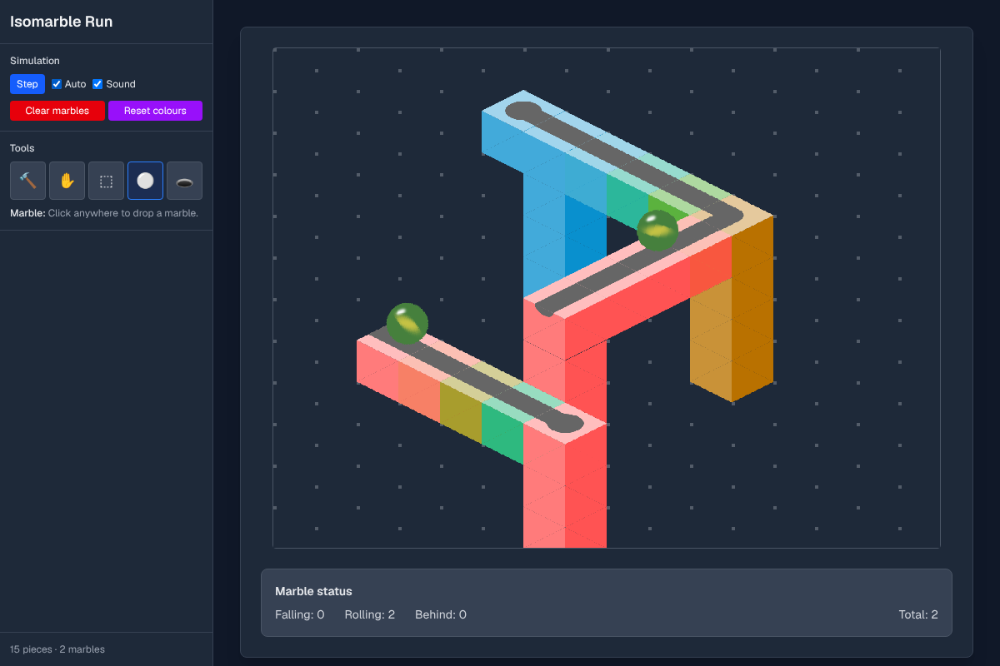

# Isomarble Run

An isometric wooden marble run where impossible tracks work. Build a run out of wooden pieces, drop in some glass marbles, and watch them roll, fall and stain the wood their colour. Pieces that only *look* connected really are connected, so you can build Escher-style loops that go downhill forever.

**Play it:** https://james-ws-mccullough.github.io/isomarble-run/



## How to play

| Tool | What it does |
| --- | --- |
| 🔨 Build (B) | Click the grid, or the top or side of a piece, to place the selected piece there. **R** rotates it. Pieces snap to the depth where they join up with the track, so you can build impossible joins just by drawing what you want to see. **[** and **]** slide a piece further away or closer without moving it on screen. |
| ✋ Move (V) | Drag a piece somewhere else. **R** rotates the piece under the pointer. |
| 🔮 Marble (M) | Click anywhere to drop a marble. |
| 🧽 Erase (E) | Click a piece to remove it. |

Pieces: **1** Straight, **2** Curve, **3** Splitter, **4** Crossing, **5** Catcher, **6** Block.

| Control | Action |
| --- | --- |
| Right-click | Remove a piece (any tool) |
| Scroll | Zoom |
| Shift-drag, middle-drag or arrow keys | Pan |
| [ / ] | Slide the piece you're placing further away / closer |
| Space | Play / pause |
| Ctrl+Z / Ctrl+Y | Undo / redo |
| Ctrl+S | Save |

**💾 Save** (Ctrl+S) keeps your run in this browser, and **📂 My runs** shows all your saved runs as a grid of thumbnails to open, rename or delete. Your current track is also autosaved, so it's still there when you come back.

Press **Load example** to get the starter track back: Escher's Waterfall, where marbles fall off a tower and roll along a "flat" track back to the top.

## Running locally

You'll need [Node.js](https://nodejs.org) 20 or newer.

```bash
npm install
npm run dev
```

Then open http://localhost:3000.

### Scripts

| Command | What it does |
| --- | --- |
| `npm run dev` | Start the development server |
| `npm run build` | Build the static site into `out/` |
| `npm run check` | Run lint, type checking and tests (what CI runs) |
| `npm run lint` / `npm run lint:fix` | Check / fix formatting and lint with [Biome](https://biomejs.dev) |
| `npm run typecheck` | Type-check with TypeScript |
| `npm test` | Run the unit tests with [Vitest](https://vitest.dev) |

## How it works

The world is a real 3D grid (x and y across, z up), drawn with a true isometric camera that looks along the diagonal (−1, −1, −1). From that angle, a point and the point one step along *every* axis, p + (1, 1, 1), land on exactly the same spot on screen. A piece one level down and one step forward looks identical to a piece right next door, and the simulation uses that:

- **"If it looks connected, it is connected."** When a marble reaches the edge of a piece, it rolls onto any piece whose groove visibly carries on from this one, at whatever depth it really is. The marble slides along your line of sight to get there, which is invisible from this camera. A join only counts if no wood covers it: heading down the screen (+x or +y) the next piece must be at the same depth or closer to you; heading up the screen it must be the same depth or further away. Otherwise the front wall of one piece would hang over the join and it would look like a step.
- **Building impossible joins.** Every spot on screen is really a whole line of 3D positions. When you place a grooved piece, the game tries each one and picks the one where the piece joins up seamlessly with the most neighbouring track, so you can draw a join and let it work out the hidden depth. Pieces can sit below the floor if that's where a join needs them.
- **Falling uses real gravity.** Marbles leave the end of a track with their speed and fall in an arc. Pieces are solid: a falling marble bounces off their sides and drops down gaps between them, hidden behind anything in front of it. A marble that set off towards the camera also lands on any top face it visibly reaches, even one that is really closer to the camera. A marble falling off the back of a track drops *behind* pieces in front of it.
- **Speed is real too, within limits.** Falls speed marbles up, friction slows them back down to a gentle cruising speed on the flat, curves scrub off a little speed, and catchers bounce marbles back. Falling speed is capped, so endless loops settle into a steady pace.
- **Grooves are rounded channels.** The 3D models and the physics share one groove shape, so marbles sit snugly in the bottom of the groove, roll down into it if they land on the edge, and bounce off the side of a piece that has no opening. Catchers have a wide round bowl with an exit groove, so they catch marbles that land near their edge. Marbles rolling across flat blocks are level with the tops of other pieces, so they roll over the rim into a groove or bowl instead of bouncing off.
- **Marbles bump into each other.** They collide when they visibly touch, either really touching in 3D or rolling on track that visibly joins (even across a hidden change of depth). Marbles that only overlap because one is passing in front of the other don't collide. A marble on track keeps the part of a bump that runs along its groove, so a head-on hit sends it back the way it came.
- Marbles that fall off the bottom of the board come back in at the top. Each marble stains the pieces it rolls over and changes colour every time it starts a new fall.

Everything is drawn with [three.js](https://threejs.org) via [React Three Fiber](https://r3f.docs.pmnd.rs). The wood and marble textures are generated in code, so there are no image files to download.

### Project layout

```
src/
  app/page.tsx            Page: wires the simulation, editor, sound and board together
  components/
    Sidebar.tsx           Tools, piece palette, simulation and history controls
    PieceIcon.tsx         Isometric icons for the palette
  hooks/
    useEditor.ts          Tools, keyboard shortcuts and the undoable track
    useHistory.ts         Undo/redo for any value
    useSaves.ts           Saved runs in local storage
  lib/
    simulation.ts         Marble physics, landing and the "looks connected" rule
    track.ts              Placed pieces and fast lookups by on-screen position
    pieces.ts             Piece types and where each sends a marble
    grooves.ts            Groove shapes, shared by the 3D models and the physics
    paths.ts              Routes across the top of a piece
    space.ts              World coordinates and the isometric projection
    directions.ts         The four horizontal directions
    sound.ts              Web Audio landing taps and speed-matched rolling
    example.ts            The starter track, Escher's Waterfall
    saves.ts              Saving runs and autosaving the current track
    placement.ts          Snapping new pieces to the depth where they join up
  three/
    Board.tsx             The 3D scene, pointer handling and build preview
    CameraRig.tsx         Fixed isometric camera with zoom and pan
    PieceMesh.tsx         A wooden piece
    Marbles.tsx           Glass marbles that spin as they roll
    pieceGeometry.ts      Piece models, with rounded grooves carved into the top
    materials.ts          Stained wood and marble materials
    textures.ts           Procedural wood grain and marble swirl
public/audio/             Sound effects
```

## Deployment

Every push to `main` runs the checks in `.github/workflows/ci.yml` and publishes the static build to GitHub Pages. Pull requests run the same checks without deploying.
